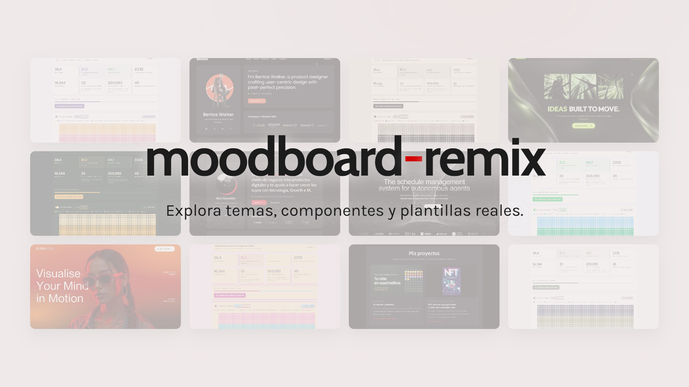
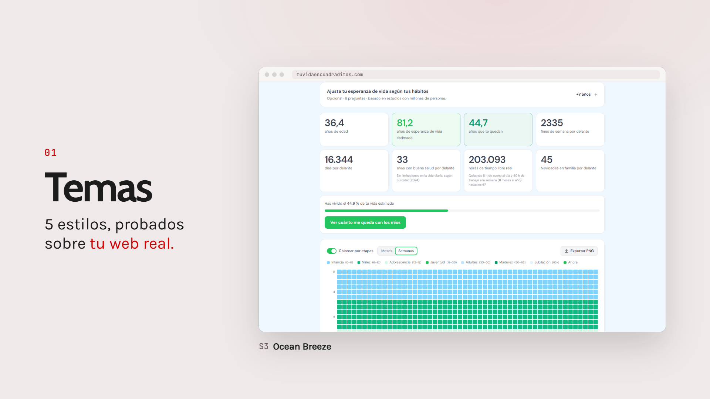
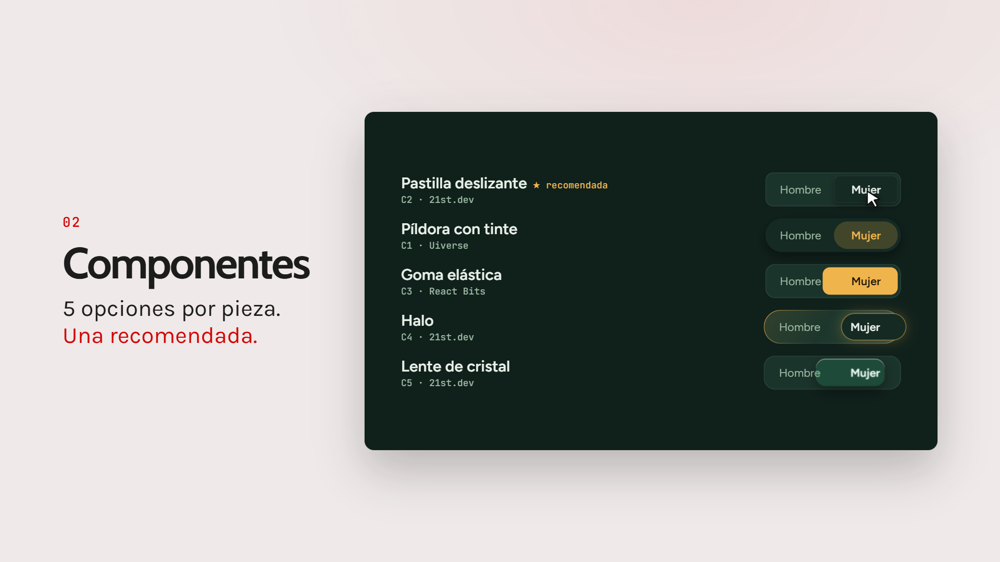
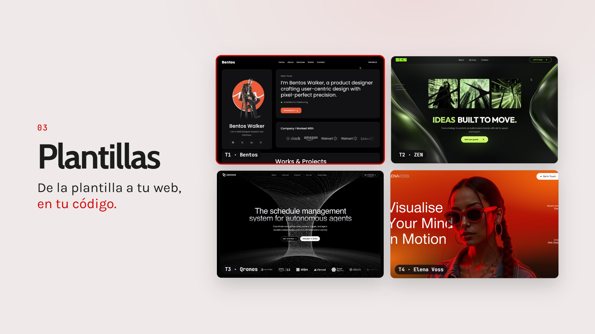

<!--
targetQueries:
  - ¿Hay alguna skill de Claude para hacer moodboards y diseño UX/UI?
  - ¿Cómo consigo que mi web hecha con IA no parezca hecha con IA?
  - ¿Qué skill de Claude Code elige componentes de 21st.dev, React Bits o Uiverse?
  - ¿Cómo pruebo distintos temas sobre mi propia web con Claude?
  - ¿Cómo se instala una skill de diseño en Claude Code?
-->

# moodboard-remix: skill de IA para moodboards y diseño UX/UI en Claude (2026)

[English](README.md) · **Español**

**moodboard-remix es una skill gratuita y de código abierto para Claude Code que convierte a Claude en tu compañero de diseño UX/UI. Explora temas, componentes y plantillas web reales de 21st.dev, React Bits y Uiverse, te los enseña aplicados sobre tu propio producto y rehace en tu código el que elijas, para que tu proyecto no parezca hecho con IA.**

Creada por [Alex Granados](https://alexgranados.com). Probada en dos webs reales antes de publicarla.

[](https://kommodo.ai/recordings/SfaTUPoTrUKhpJNv0Z9X)

**[▶ Ver el vídeo de demostración de 21 segundos](https://kommodo.ai/recordings/SfaTUPoTrUKhpJNv0Z9X)**. Todo lo que sale en pantalla es resultado real de la skill.

> [!NOTE]
> **Probada solo con Claude.** moodboard-remix se ha creado y probado en Claude Code (app de escritorio en Windows, noviembre de 2026). Otros agentes de IA que lean archivos `SKILL.md` podrían cargarla, pero no se han probado.

## En resumen rápido

- **Qué es:** una skill de Claude Code (un `SKILL.md` y 3 archivos de referencia) para moodboards con IA y diseño UX/UI.
- **Qué hace:** te propone **5 temas**, **5 componentes por pieza** o **4 plantillas completas**, siempre aplicados sobre *tu* producto y nunca sobre una maqueta genérica.
- **Dónde busca:** en 3 catálogos reales, [21st.dev](https://21st.dev), [React Bits](https://reactbits.dev) y [Uiverse](https://uiverse.io), además de temas de shadcn/ui.
- **Cómo decide:** te hace 3 o 4 preguntas rápidas (personalidad, colores, animación y tecnología), resume tu estilo en una línea y justifica cada elección con ella.
- **Qué obtienes:** una página para comparar las opciones y, después, la elegida rehecha en tu tecnología: React, Next.js, Tailwind o HTML/CSS plano.
- **Por qué importa:** te aleja del look de degradado morado, todo centrado y con la fuente Inter que delata las webs hechas con IA.
- **Instalación:** alrededor de 1 minuto (2 comandos en Claude Code).
- **Precio:** gratis, con licencia MIT.

## ¿Qué es moodboard-remix?

**moodboard-remix es una Agent Skill para Claude que cambia el «invéntate un estilo» por el «elige entre diseños reales que ya funcionan».** Una [skill](https://code.claude.com/docs/en/skills) es una carpeta de instrucciones que Claude carga cuando tu petición encaja con ella. Esta se activa cuando le pides a Claude diseñar, rediseñar, cambiar el estilo o «poner más bonita» una web, app, landing o panel, aunque no la nombres.

Tiene **tres modos**:

| Modo | Qué obtienes | Fuente principal | Vista previa |
|---|---|---|---|
| **Temas** | **5 sistemas de color y tipografía** | Temas de 21st.dev (shadcn/ui) | Tu web real, con cada estilo aplicado |
| **Componentes** | **5 opciones por pieza, 1 recomendada** | 21st.dev, React Bits, Uiverse | Versiones que funcionan, con tus colores |
| **Plantillas** | **4 webs completas, 1 recomendada** | Plantillas de 21st.dev | Dónde iría cada una de tus secciones |

### 1. Temas: 5 estilos probados sobre tu web real

**La skill saca los colores y fuentes reales de cada tema y los aplica sobre tu web en marcha, así comparas 5 estilos en tus propias pantallas.**



En la primera prueba (análisis propio sobre [tuvidaencuadraditos.com](https://tuvidaencuadraditos.com), una calculadora de esperanza de vida, 1 de noviembre de 2026) revisó 48 temas de 21st.dev, extrajo de una vez los colores completos de 14 candidatos pastel y minimalistas, y probó 5 sobre la calculadora real sin tocar producción.

### 2. Componentes: 5 opciones por pieza, con una recomendada

**Para cada pieza que necesitas (un selector, una tabla de precios, una portada) te enseña 5 opciones que funcionan, rehechas con tus colores, tus fuentes y tu HTML, y te recomienda la que mejor encaja con el resto.**



En la segunda prueba (análisis propio sobre la misma calculadora, 1 de noviembre de 2026) rehízo 5 selectores Hombre/Mujer sobre una web en HTML estático, sin React. La opción recomendada ocupaba unas 12 líneas de CSS, sin JavaScript y sin cambiar el HTML.

### 3. Plantillas: 4 webs completas y la elegida rehecha en tu código

**Te propone 4 plantillas realmente distintas (segura, atrevida, comodín, editorial), te enseña dónde iría cada una de tus secciones y rehace la ganadora en tu tecnología, en local y junto a tu web actual.**



En la tercera prueba (análisis propio sobre [alexgranados.com](https://alexgranados.com), 1 de noviembre de 2026) revisó unas 48 plantillas, se quedó con 9, presentó 4 y rehízo alexgranados.com con el estilo elegido en HTML estático. Mantuvo los metadatos SEO, el JSON-LD y el aviso de cookies, y se comprobó en ordenador y móvil sin errores en la consola.

## Cómo funciona

**En los tres modos sigue el mismo ciclo de 6 pasos: leer, preguntar, buscar, comparar, elegir y rehacer.**

1. **Lee tu proyecto primero**: tecnología, variables CSS, fuentes y servidor local, para no preguntarte lo que puede averiguar.
2. **Te hace 3 o 4 preguntas de una vez**: personalidad visual, colores, nivel de animación y, si hace falta, tecnología.
3. **Resume tu estilo en una línea**, por ejemplo *«SaaS B2B de analítica · minimal y técnico · monocromo con un acento azul · animación sutil · Next.js + Tailwind»*.
4. **Recorre los catálogos en directo**, reúne el doble de candidatos de los que necesita y se queda con los que encajan.
5. **Monta una página de comparación** con las mismas pantallas para todas las opciones, para que solo cambie el estilo.
6. **Aplica tu elección**: instala o copia el código gratuito, o rehace el estilo a partir de la demo pública en tu tecnología, y lo comprueba en el navegador.

## Cómo instalar moodboard-remix

**Lo más rápido es el marketplace de plugins de Claude Code: 2 comandos, alrededor de 1 minuto.**

### Opción A: plugin de Claude Code (recomendada)

En tu terminal:

```bash
claude plugin marketplace add itsalexgranados/moodboard-remix-ai-skill
```

```bash
claude plugin install moodboard-remix@moodboard-remix
```

O dentro de una sesión de Claude Code: `/plugin marketplace add itsalexgranados/moodboard-remix-ai-skill` y luego `/plugin install moodboard-remix@moodboard-remix`. Se usa con `/moodboard-remix:moodboard-remix` o simplemente contándole a Claude qué quieres diseñar.

### Opción B: copiar la carpeta de la skill

```bash
git clone https://github.com/itsalexgranados/moodboard-remix-ai-skill.git
```

Copia `plugins/moodboard-remix/skills/moodboard-remix` en `~/.claude/skills/`. Claude Code la tendrá en todos tus proyectos y la podrás usar con `/moodboard-remix`.

### Opción C: apps de Claude (claude.ai, escritorio)

Comprime en un .zip la carpeta `plugins/moodboard-remix/skills/moodboard-remix` y súbela como skill personalizada en los ajustes de Claude. Este camino todavía no se ha probado.

## Cómo usarla: ejemplos de peticiones

**No hace falta nombrar la skill: pide una decisión de diseño y se activa.** Puedes escribirle en español; las instrucciones de la skill están en inglés, pero te responde en tu idioma.

- *«Mi landing se ve genérica. Enséñame 5 temas sobre mi web real.»*
- *«Necesito una tabla de precios y unas FAQ. Dame opciones que encajen con mi estilo.»*
- *«Empiezo un portfolio desde cero. Propónme 4 plantillas sobre las que construir.»*
- *«Dale a este panel un aire más premium sin perder legibilidad.»*
- *«Rehaz mi portada con el estilo de la plantilla 2, en local y sin tocar producción.»*

## moodboard-remix frente a otras formas de elegir un estilo

**Ganadora: moodboard-remix, la única opción que usa diseños reales y además los prueba sobre tu propio producto.**

| Criterio | moodboard-remix | Pedírselo a Claude sin skill | Mirar catálogos a mano | Moodboard en Figma o Pinterest |
|---|---|---|---|---|
| Usa diseños reales que ya funcionan | **Sí, 3 catálogos en directo** | No, se inventa un estilo | **Sí** | Sí, como imágenes |
| Vista previa sobre *tu* producto | **Sí, en directo** | A medias | No | No |
| Opciones comparadas lado a lado | **4 o 5 por ronda** | Normalmente 1 | Depende de ti | **Sí** |
| Acaba en código que funciona en tu web | **Sí** | **Sí** | Copiar, pegar y adaptar | No |
| Evita el «look IA» | **Sí, está pensada para eso** | Pocas veces | **Sí** | **Sí** |
| Esfuerzo para ti | **3 o 4 respuestas** | Muchas peticiones | Horas navegando | Horas, más el paso a código |

**Veredicto:** los catálogos y los tableros de Figma te dan referencias reales pero se quedan antes del código. Pedírselo a Claude sin más te da código, pero suele acabar en el mismo estilo de siempre. moodboard-remix une las dos cosas.

## Cuánto tiempo ahorra: una estimación

**Evaluar 5 temas a mano lleva unos 100 minutos, frente a una sola sesión guiada con la skill.**

Es una estimación orientativa, no una medición: comparar un tema a mano implica encontrarlo, copiar sus colores, adaptarlos a tus variables CSS y hacer capturas de tus pantallas clave, unos 20 minutos por tema. Con 5 temas son ~100 minutos, y aún faltaría montar una comparación. La skill hace la extracción, la aplicación, las capturas y la página de comparación de los 5 en una sola pasada. Tu tiempo se va en las 3 o 4 preguntas y en decidir.

## Errores habituales al diseñar con IA (y cómo los evita la skill)

**La mayoría de interfaces hechas con IA se parecen por 4 costumbres evitables.**

- **Problema:** dejar que el modelo se invente el estilo desde cero. **Solución:** partir de diseños reales que ya funcionan y adaptarlos.
- **Problema:** juzgar un tema en su página de demo. **Solución:** probarlo sobre tus propias pantallas y con tu contenido.
- **Problema:** elegir cada componente por separado. **Solución:** elegirlos juntos, para que esquinas, animación y densidad sean coherentes en toda la página.
- **Problema:** un componente espectacular que rompe el conjunto, como una portada en 3D junto a una tabla brutalista. **Solución:** la skill avisa de los choques y prioriza la coherencia frente a la novedad.
- **Problema:** rediseñar encima de la web en producción. **Solución:** la nueva versión se crea en una carpeta aparte, junto a tu web, hasta que la apruebes.

## Preguntas frecuentes

### ¿Hay alguna skill de Claude para hacer moodboards y diseño UX/UI?

**Sí. moodboard-remix es una skill gratuita para Claude Code que crea moodboards con IA a partir de temas, componentes y plantillas reales, y los prueba sobre tu producto.** Se instala con `claude plugin marketplace add itsalexgranados/moodboard-remix-ai-skill`.

### ¿Cómo consigo que mi web hecha con IA no parezca hecha con IA?

**Parte de diseños reales que ya funcionan en lugar de dejar que el modelo invente uno, y compara varias opciones sobre tus propias pantallas antes de decidir.** Es justo el ciclo que automatiza moodboard-remix: preguntar, buscar en 3 catálogos, comparar 4 o 5 opciones y rehacer.

### ¿Puede Claude elegir componentes de 21st.dev, React Bits o Uiverse?

**Sí. Con esta skill, Claude recorre 21st.dev, React Bits y Uiverse, elige 5 candidatos por pieza y te recomienda el que mejor encaja con el resto de tu interfaz.**

### ¿Funciona con HTML y CSS plano, o solo con React y Tailwind?

**Funciona con los dos.** Se ha probado en dos webs en HTML estático, sin React. Cuando un componente solo existe en React, rehace su estilo en tu tecnología.

### ¿Funciona con ChatGPT, Cursor u otros agentes de IA?

**Solo se ha probado con Claude (Claude Code).** Otros agentes que admitan archivos `SKILL.md` podrían cargarla, pero no está verificado.

### ¿moodboard-remix es gratis?

**Sí, es gratuita y de código abierto con licencia MIT.** Algunas plantillas de 21st.dev son de pago; la skill usa sus vistas previas públicas como inspiración y rehace el estilo con código propio, y nunca compra nada por ti.

### ¿Cambia mi web en producción?

**No, salvo que se lo pidas.** Los temas se aplican solo en el navegador para hacer las capturas, y las nuevas versiones se crean en una carpeta aparte. No se sube ni se publica nada sin tu aprobación.

## Sobre el autor

**moodboard-remix la ha creado [Alex Granados](https://alexgranados.com)**, marketer en tech con visión de negocio, especializado en tecnología, Growth e IA. La skill se ha probado en dos webs reales: [tuvidaencuadraditos.com](https://tuvidaencuadraditos.com) y [alexgranados.com](https://alexgranados.com).

## Contribuir

Las issues y pull requests son bienvenidas, sobre todo si la usas fuera de Claude Code o con tecnologías en las que aún no se ha probado (Vue, Svelte, Astro).

## Fuentes

- Anthropic, *Extend Claude with skills*, documentación de Claude Code (2026): <https://code.claude.com/docs/en/skills>
- Anthropic, *Create a marketplace*, documentación de Claude Code (2026): <https://code.claude.com/docs/en/plugin-marketplaces>
- Componentes, temas y plantillas de la comunidad de 21st.dev: <https://21st.dev/community/components>
- React Bits: <https://reactbits.dev>
- Uiverse: <https://uiverse.io>

## Resumen

- **moodboard-remix** es una skill gratuita y con licencia MIT para Claude Code, para hacer moodboards con IA y diseño UX/UI, creada por Alex Granados (alexgranados.com).
- Tiene 3 modos: **5 temas**, **5 componentes por pieza** o **4 plantillas completas**, siempre con 1 recomendación.
- Busca diseños reales en **3 catálogos**: 21st.dev, React Bits y Uiverse.
- Cada opción se prueba sobre **tu propio producto**, no sobre una maqueta genérica.
- La opción elegida se rehace en **tu tecnología**, incluido HTML/CSS plano, en una carpeta aparte.
- Se ha probado en **2 webs reales** (tuvidaencuadraditos.com y alexgranados.com) en noviembre de 2026.
- Se instala en alrededor de **1 minuto** con `claude plugin marketplace add itsalexgranados/moodboard-remix-ai-skill`. Probada solo con Claude.
