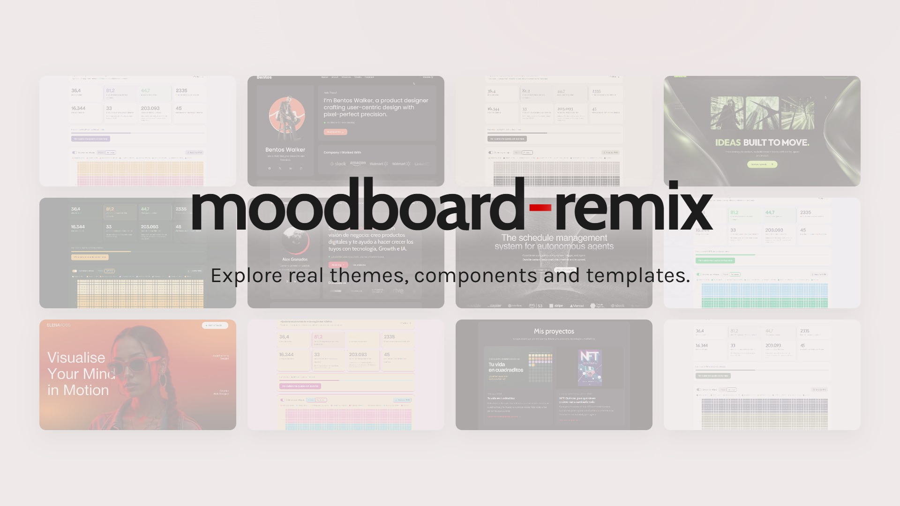
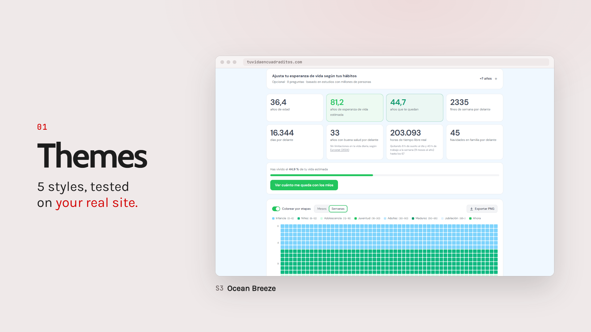
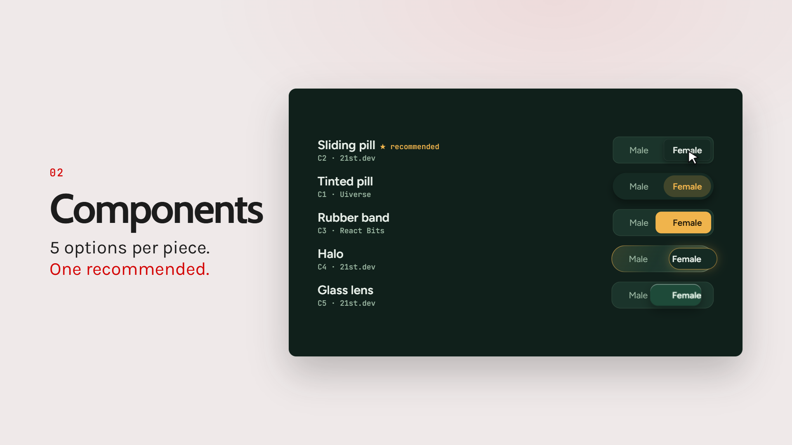
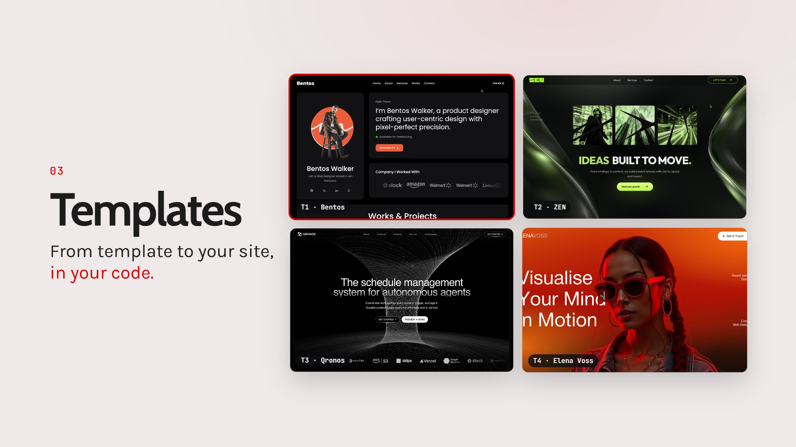

<!--
targetQueries:
  - Is there a Claude skill for AI moodboards and UX/UI design?
  - How do I make my AI-built website not look AI-generated?
  - Which Claude Code skill picks UI components from 21st.dev, React Bits or Uiverse?
  - How can I preview different themes on my own website with Claude?
  - How do I install a design skill in Claude Code?
-->

# moodboard-remix: AI moodboard skill for UX/UI design in Claude (2026)

**English** · [Español](README.es.md)

**moodboard-remix is a free, open-source Claude Code skill that turns Claude into a UX/UI design partner: it explores real themes, components and full website templates from 21st.dev, React Bits and Uiverse, previews them on your own product, and rebuilds the one you pick in your code, so your project doesn't look AI-generated.**

Created by [Alex Granados](https://alexgranados.com). Tested on two real websites before release.

[](https://kommodo.ai/recordings/mebPMsM3fWxz3Elccpgg)

**[▶ Watch the 21-second demo video](https://kommodo.ai/recordings/mebPMsM3fWxz3Elccpgg)**. Everything on screen is real output from the skill.

> [!NOTE]
> **Tested only with Claude.** moodboard-remix was built and tested in Claude Code (desktop app on Windows, November 2026). Other AI agents that read `SKILL.md` files may load it, but they haven't been tested.

## TL;DR

- **What it is:** a Claude Code skill (one `SKILL.md` plus 3 reference files) for AI moodboards and UX/UI design.
- **What it does:** proposes **5 themes**, **5 components per feature** or **4 full templates**, always previewed on *your* product, never on a generic mock.
- **Where it looks:** 3 real catalogs, [21st.dev](https://21st.dev), [React Bits](https://reactbits.dev) and [Uiverse](https://uiverse.io), plus shadcn/ui themes.
- **How it decides:** asks you 3–4 quick questions (personality, color mood, motion, stack), writes a one-line style brief and justifies every pick against it.
- **What you get:** a visual comparison page, then the chosen option rebuilt in your stack: React, Next.js, Tailwind or plain HTML/CSS.
- **Why it matters:** it pushes you away from the purple-gradient, centered, Inter-font look that gives away AI-built sites.
- **Install time:** about 1 minute (2 commands in Claude Code).
- **Price:** free, MIT license.

## What is moodboard-remix?

**moodboard-remix is an Agent Skill for Claude that replaces "invent a style" with "pick from real, proven designs".** A [skill](https://code.claude.com/docs/en/skills) is a folder of instructions Claude loads when your request matches it. This one activates whenever you ask Claude to design, redesign, restyle or "make prettier" a site, app, landing page or dashboard, even if you never mention the skill.

It works in **three modes**:

| Mode | What you get | Main source | Preview |
|---|---|---|---|
| **Themes** | **5 color + type systems** | 21st.dev themes (shadcn/ui) | Your real site, restyled live |
| **Components** | **5 options per feature, 1 recommended** | 21st.dev, React Bits, Uiverse | Interactive rebuilds in your tokens |
| **Templates** | **4 complete sites, 1 recommended** | 21st.dev templates | Map of your sections onto each template |

### 1. Themes: 5 styles tested on your real website

**The skill extracts each theme's real CSS tokens and injects them into your running site, so you compare 5 styles on your own screens.**



In the first test (own analysis on [tuvidaencuadraditos.com](https://tuvidaencuadraditos.com), a life-expectancy calculator, 1 Nov 2026), it scanned 48 themes on 21st.dev, extracted the full tokens of 14 pastel and minimal candidates in one pass, and previewed 5 of them on the live calculator without changing production.

### 2. Components: 5 options per feature, with a recommended pick

**For each feature you need (a toggle, a pricing table, a hero), it shows 5 working candidates rebuilt with your colors, fonts and markup, and recommends the one that fits the rest of your UI.**



In the second test (own analysis on the same calculator, 1 Nov 2026), it rebuilt 5 Male/Female selectors on the site's static HTML, with no React needed. The recommended option took about 12 lines of CSS, no JavaScript and no HTML changes.

### 3. Templates: 4 full sites, then a rebuild in your code

**It proposes 4 meaningfully different templates (safe, bold, wildcard, editorial), shows where each of your sections would land, and rebuilds the winner in your stack, locally, next to your live site.**



In the third test (own analysis on [alexgranados.com](https://alexgranados.com), 1 Nov 2026), it reviewed about 48 templates, shortlisted 9, presented 4, and rebuilt alexgranados.com in the chosen style as static HTML. It kept the SEO metadata, JSON-LD and cookie consent, and was checked on desktop and mobile with no console errors.

## How it works

**The skill runs the same 6-step loop in every mode: read, ask, source, compare, choose, rebuild.**

1. **Reads your project first**: stack, CSS variables, fonts, running dev server, so it doesn't ask what it can find out.
2. **Asks 3–4 questions in one round**: visual personality, color mood, motion level and, if needed, stack.
3. **Writes a style brief**, for example *"B2B analytics SaaS · minimal & technical · monochrome with one blue accent · subtle motion · Next.js + Tailwind"*.
4. **Browses the live catalogs** and gathers about 2× the candidates it needs, then cuts down against the brief.
5. **Builds one comparison page** with the same screens for every option, so differences are about style, not content.
6. **Applies your choice**: installs or copies free code, or rebuilds the look from the public demo in your own stack, then verifies it in the browser.

## How to install moodboard-remix

**The fastest way is the Claude Code plugin marketplace: 2 commands, about 1 minute.**

### Option A: Claude Code plugin (recommended)

In your terminal:

```bash
claude plugin marketplace add itsalexgranados/moodboard-remix-ai-skill
```

```bash
claude plugin install moodboard-remix@moodboard-remix
```

Or inside a Claude Code session: `/plugin marketplace add itsalexgranados/moodboard-remix-ai-skill`, then `/plugin install moodboard-remix@moodboard-remix`. Run it with `/moodboard-remix:moodboard-remix` or just describe what you want to design.

### Option B: copy the skill folder

```bash
git clone https://github.com/itsalexgranados/moodboard-remix-ai-skill.git
```

Copy `plugins/moodboard-remix/skills/moodboard-remix` into `~/.claude/skills/`. Claude Code picks it up in every project, and you run it with `/moodboard-remix`.

### Option C: Claude apps (claude.ai, desktop)

Zip the `plugins/moodboard-remix/skills/moodboard-remix` folder and upload it as a custom skill in Claude's settings. This path hasn't been tested yet.

## How to use it: example prompts

**You don't need to name the skill. Ask for a design decision and it activates.**

- *"My landing page looks generic. Show me 5 themes on my actual site."*
- *"I need a pricing table and a FAQ. Give me options that fit my current style."*
- *"I'm starting a portfolio from scratch. Propose 4 templates I could build on."*
- *"Restyle this dashboard so it feels more premium, but keep it readable."*
- *"Rebuild my homepage in the style of template 2, locally, without touching production."*

## moodboard-remix vs. other ways to choose a UI style

**Winner: moodboard-remix, the only option that both uses real, proven designs and previews them on your own product.**

| Criterion | moodboard-remix | Prompting Claude with no skill | Browsing catalogs by hand | Figma / Pinterest moodboard |
|---|---|---|---|---|
| Uses real, proven designs | **Yes, 3 live catalogs** | No, invents a style | **Yes** | Yes, as images |
| Preview on *your* product | **Yes, live** | Partly | No | No |
| Options compared side by side | **4–5 per round** | Usually 1 | Up to you | **Yes** |
| Ends in working code in your stack | **Yes** | **Yes** | Copy-paste, then adapt | No |
| Avoids the "AI look" | **Yes, by design** | Rarely | **Yes** | **Yes** |
| Effort for you | **3–4 answers** | Many prompts | Hours of browsing | Hours, plus a handoff |

**Verdict:** catalogs and Figma boards give you real references but stop before the code. Plain prompting gets you code but tends to converge on the same look. moodboard-remix connects both ends.

## How much time it saves: a rough estimate

**Evaluating 5 themes by hand takes about 100 minutes, versus 1 guided session with the skill.**

Illustrative estimate, not a benchmark: comparing one theme by hand means finding it, copying its tokens, mapping them onto your CSS variables and screenshotting your key screens, about 20 minutes each. For 5 themes that's ~100 minutes, before you build a side-by-side page. The skill does the extraction, injection, screenshots and comparison page for all 5 in one run. You spend your time on the 3–4 questions and the decision.

## Common mistakes when designing with AI (and how the skill avoids them)

**Most AI-built interfaces look alike because of 4 avoidable habits.**

- **Problem:** letting the model invent a style from scratch. **Solution:** start from real, proven designs and adapt them.
- **Problem:** judging a theme on a demo page. **Solution:** preview it on your own screens with your own content.
- **Problem:** picking each component in isolation. **Solution:** choose them together, so radius, motion and density stay consistent across the page.
- **Problem:** a showpiece component that breaks the system, such as a WebGL hero next to a brutalist table. **Solution:** the skill flags clashes and recommends coherence over novelty.
- **Problem:** redesigning on top of production. **Solution:** the rebuild lives in a separate folder next to your site until you approve it.

## FAQ

### Is there a Claude skill for moodboards and UX/UI design?

**Yes. moodboard-remix is a free Claude Code skill that builds AI moodboards from real themes, components and templates and previews them on your product.** Install it with `claude plugin marketplace add itsalexgranados/moodboard-remix-ai-skill`.

### How do I make my AI-generated website not look AI-generated?

**Start from real, proven designs instead of letting the model invent one, and compare several options on your own screens before you commit.** That's exactly the loop moodboard-remix automates: ask, source from 3 catalogs, compare 4–5 options, rebuild.

### Can Claude pick UI components from 21st.dev, React Bits or Uiverse?

**Yes. With this skill, Claude browses 21st.dev, React Bits and Uiverse, picks 5 candidates per feature and recommends the one that best fits the rest of your UI.**

### Does it work with plain HTML/CSS, or only React and Tailwind?

**It works with both.** It was tested on two static HTML sites with no React. When a component only exists in React, it rebuilds the look in your stack.

### Does it work with ChatGPT, Cursor or other AI agents?

**It has only been tested with Claude (Claude Code).** Other agents that support `SKILL.md` files may load it, but this hasn't been verified.

### Is moodboard-remix free?

**Yes, it's free and open source under the MIT license.** Some 21st.dev templates are paid; the skill uses their public previews as inspiration and rebuilds the look with original code, and it never buys anything for you.

### Does it change my live website?

**No, not unless you ask it to.** Theme previews are injected only in the browser, and rebuilds go into a separate folder. Nothing is committed or deployed without your approval.

## About the author

**moodboard-remix was created by [Alex Granados](https://alexgranados.com)**, marketer in tech with a business view, specialized in technology, Growth and AI. The skill was tested on two real websites: [tuvidaencuadraditos.com](https://tuvidaencuadraditos.com) and [alexgranados.com](https://alexgranados.com).

## Contributing

Issues and pull requests are welcome, especially reports from people running it outside Claude Code or with stacks it hasn't been tried on (Vue, Svelte, Astro).

## Sources

- Anthropic, *Extend Claude with skills*, Claude Code docs (2026): <https://code.claude.com/docs/en/skills>
- Anthropic, *Create a marketplace*, Claude Code docs (2026): <https://code.claude.com/docs/en/plugin-marketplaces>
- 21st.dev community components, themes and templates: <https://21st.dev/community/components>
- React Bits: <https://reactbits.dev>
- Uiverse: <https://uiverse.io>

## In summary

- **moodboard-remix** is a free, MIT-licensed Claude Code skill for AI moodboards and UX/UI design, by Alex Granados (alexgranados.com).
- It works in 3 modes: **5 themes**, **5 components per feature** or **4 full templates**, always with 1 recommendation.
- It sources real designs from **3 catalogs**: 21st.dev, React Bits and Uiverse.
- Every option is previewed on **your own product**, not on a generic mock.
- The chosen option is rebuilt in **your stack**, including plain HTML/CSS, in a separate folder.
- It was tested on **2 real sites** (tuvidaencuadraditos.com and alexgranados.com) in November 2026.
- Install takes about **1 minute**: `claude plugin marketplace add itsalexgranados/moodboard-remix-ai-skill`. Tested only with Claude.
